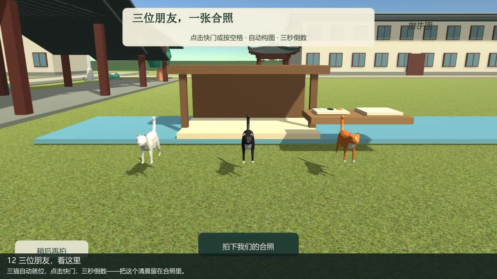

# 校园猫猫观察日记

一个使用 Unity 制作的三维校园探索与猫咪摄影游戏。在清晨的校园里，慢慢认识九尾、黑白咪和顶流毛毛，用陪伴、玩具、食物与照片记录三位朋友的日常。

## 功能演示

[](https://github.com/Watendy66/Campus_cat/raw/refs/heads/main/docs/demo.mp4)

**[播放或下载完整 Demo（2分32秒，含背景音乐）](https://github.com/Watendy66/Campus_cat/raw/refs/heads/main/docs/demo.mp4)** · [查看仓库中的视频文件](docs/demo.mp4)

视频为实际游戏运行录制，展示角色选择、校园探索、猫咪互动、摄影任务、手账相册及最后的三猫合照。格式为 MP4，1280×720、24 fps，约45.5 MiB。若浏览器没有直接播放，下载后使用本地播放器打开即可。

## 如何开始游戏

仓库提供完整 Unity 工程及演示视频。进入游戏需要 Unity 编辑器，也可以自行构建 Windows 试玩版。

### 环境

- Windows，键盘与鼠标。
- **Unity 2018.4.36f1**，内置渲染管线；建议使用该版本打开。
- 若要导出可执行程序，编辑器需安装 **Windows Build Support**。

### 获取与打开工程

1. 克隆仓库，或点击仓库页面的 **Code → Download ZIP** 并解压：

   ```bash
   git clone https://github.com/Watendy66/Campus_cat.git
   ```

2. 在 Unity Hub 中选择添加已有项目，定位到含有 `Assets`、`Packages`、`ProjectSettings` 的 **Campus_cat 根目录**，不要只选择 `Assets` 文件夹。
3. 使用 Unity 2018.4.36f1 打开，等待首次素材导入与脚本编译完成。`Library` 缓存会由编辑器自动生成。
4. 在 Project 面板中打开 [`Assets/CampusCats/Generated/Campus.unity`](Assets/CampusCats/Generated/Campus.unity)。
5. 点击编辑器顶部的 **Play**，在主菜单选择“开始今天的观察”，再选择男性或女性角色。

场景、模型、动画与配置已经接好，无需重新生成地图。音乐可在主菜单或暂停后的设置中调节。

## 操作说明

| 按键 | 功能 |
| --- | --- |
| WASD | 移动 |
| 鼠标移动 | 转动视角 |
| Shift | 奔跑 |
| Ctrl | 蹲下 |
| E | 交互、拾取、阅读记录或抚摸朋友 |
| 1 / 2 | 选择食物 / 小球 |
| Q | 放下食物或投出小球 |
| 鼠标右键 | 进入 / 退出摄影模式 |
| 鼠标左键 | 摄影模式下拍照 |
| 鼠标滚轮 | 摄影模式下调整焦距 |
| J / P | 打开手账 / 相册 |
| Esc | 暂停或关闭面板；合照时可取消并稍后重拍 |
| 合照快门按钮 / 空格 | 合照仪式中启动三秒倒数 |

## 怎么推进故事

1. **认识九尾**：蹲下缓慢接近，在约3.2—6米的距离安静陪伴。根据提示建立信任，再举起相机拍照。亲密值达到20后成为朋友，靠近不再扣值，也不再显示亲密数值；靠近按E可以抚摸。
2. **跟随九尾**：跟着它经过教学楼侧面的观察路线。落后时，它会等待玩家。
3. **找到黑白咪的小球**：去庭院的长椅附近，按E拾取小球。
4. **抓拍扑球**：选择小球并投出，在秘密小路附近拍下黑白咪扑玩的瞬间。错过可捡回小球重试。
5. **喂顶流毛毛**：选择食物并放下，退到食物约3.4米以外，等待它闻嗅和进食。
6. **留下三猫合照**：跟随标记到树下阅读照料记录，点击准备合照。三猫自动就位、镜头自动构图，点击快门或按空格，倒数三秒后完成最后一页日记。

任何一个任务暂时过不去，都可以在暂停界面或手账中选择跳过。J可查看当前故事记录，P可浏览本局实际拍下的照片；最后一张三猫合照也会进入相册。

**本项目没有跨启动存档。** 退出或重新开始会清空本局任务、信任和照片；普通暂停与翻阅手账不会清空进度。结局后可以留在校园继续探索和拍照。

## 构建 Windows 试玩版

1. 确认编辑器已安装 Windows Build Support，且脚本编译完成。
2. 选择菜单 **校园猫猫 → 构建 Windows 试玩版**，再选择输出目录。
3. 构建完成后运行 `CampusCats.exe`。分发时保留整个输出目录，包含同目录的数据文件夹与运行库。

该菜单使用现有 Campus 场景进行构建，不重建或覆盖地图。

## 工程结构

| 目录 | 内容 |
| --- | --- |
| `Assets/CampusCats/Scripts` | 角色控制、猫咪行为、信任、摄影、任务、UI与音乐 |
| `Assets/CampusCats/Generated` | 校园场景、配置和场景资源 |
| `Assets/CampusCats/Art` | 模型、动画、材质及环境素材 |
| `Assets/CampusCats/Resources` | 纸纹、背景音乐及界面着色器 |
| `Assets/CampusCats/Editor` | 场景打开和Windows构建菜单 |
| `Packages` / `ProjectSettings` | 包配置与工程设置 |
| `docs` | 功能演示视频及预览图 |

`Library`、`Temp`、日志、实验报告和临时录制工具不纳入仓库。

## 素材与验证

保留项目原有 **Campus Diary** 署名。第三方素材的原始许可文件保存在相应目录，来源见[素材说明](素材说明.md)。背景音乐使用项目提供的《莫奈花园-情书海》，不标记为开源音乐。

当前场景此前已完成正常主线运行，20项流程检查通过且未跳过任务；结尾与音乐17项检查通过。整理后的代码另通过C#编译和移除脚本引用检查；尚未重新执行干净缓存导入后的独立Player全流程验收。
